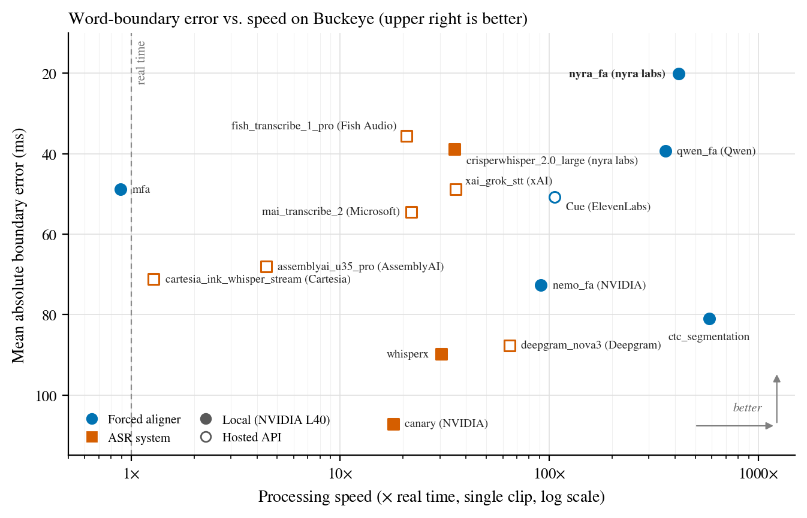

# Nyra Speech Timing Benchmark

How precisely do speech systems place **word boundaries**? This benchmark
scores word-level timestamps against hand-labelled references on
conversational speech (Buckeye), stuttered speech (FluencyBank) and read speech
under noise (TIMIT), for open-source forced aligners, ASR models and hosted
speech APIs, and measures how fast each system runs.

## Leaderboard

Per-word timing on the full test sets. **Acc@X** = share of words whose start
*and* end are both within X of the reference. Forced aligners are given the
transcript; ASR systems are timed on the words they recognised, so read their
accuracy together with **word recall**. **Speed** = how many times faster than
real time a system processes one clip (higher is faster, see [Speed](#speed)).
Exact definitions of all metrics are in [Metric definitions](#metric-definitions).
All local systems ran on a single NVIDIA L40 GPU. Full tables, including TIMIT
and F1, are in [`docs/RESULTS.md`](docs/RESULTS.md).

### Accuracy vs. speed



Each point is one system on Buckeye: mean absolute boundary error (up = more
accurate) against processing speed (right = faster, log scale). Blue circles
are forced aligners, orange squares ASR systems; hollow markers are hosted APIs.
The best systems sit in the upper right.

### Buckeye (conversational speech, 2,008 clips, 80,507 words)

| System | Type | Deployment | Word recall | MAE (ms) | mIoU | Acc@25ms | Acc@50ms | Acc@100ms | Acc@200ms | Speed (× real time) |
| --- | --- | --- | ---: | ---: | ---: | ---: | ---: | ---: | ---: | ---: |
| `nyra_fa` (nyra labs) | forced aligner | local | 100.0 | 20.1 | 83.0 | 63.3 | 88.8 | 97.2 | 99.3 | 418× |
| `mfa` | forced aligner | local | 98.7 | 48.9 | 78.2 | 52.5 | 78.3 | 91.2 | 95.9 | 0.9× |
| `fish_transcribe_1_pro` (Fish Audio) | ASR system | hosted API | 93.2 | 35.5 | 71.9 | 28.9 | 75.8 | 94.9 | 98.4 | 21× |
| `qwen_fa` (Qwen) | forced aligner | local | 99.9 | 39.4 | 71.1 | 28.7 | 75.0 | 94.4 | 97.9 | 359× |
| `crisperwhisper_2.0_large` (nyra labs) | ASR system | local | 93.2 | 38.8 | 71.7 | 32.7 | 66.1 | 87.4 | 96.7 | 35× |
| `xai_grok_stt` (xAI) | ASR system | hosted API | 92.9 | 48.8 | 62.8 | 15.3 | 50.5 | 87.8 | 97.5 | 36× |
| `ctc_segmentation` | forced aligner | local | 100.0 | 81.0 | 63.5 | 18.3 | 48.8 | 75.0 | 85.9 | 582× |
| `cartesia_ink_whisper_stream` (Cartesia) | ASR system | hosted API | 87.7 | 71.2 | 61.1 | 14.3 | 38.2 | 68.5 | 86.4 | 1.3× |
| Cue (ElevenLabs) | forced aligner | hosted API | 100.0 | 50.8 | 58.4 | 7.5 | 32.4 | 81.4 | 98.3 | 106× |
| `mai_transcribe_2` (Microsoft) | ASR system | hosted API | 91.7 | 54.4 | 56.0 | 8.9 | 31.0 | 73.2 | 98.1 | 22× |
| `assemblyai_u35_pro` (AssemblyAI) | ASR system | hosted API | 88.7 | 68.1 | 53.6 | 8.9 | 30.9 | 74.6 | 95.8 | 4.4× |
| `nemo_fa` (NVIDIA) | forced aligner | local | 100.0 | 72.6 | 44.3 | 5.5 | 20.4 | 58.8 | 94.8 | 91× |
| `deepgram_nova3` (Deepgram) | ASR system | hosted API | 92.7 | 87.6 | 49.5 | 3.8 | 14.8 | 50.9 | 89.5 | 65× |
| `canary` (NVIDIA) | ASR system | local | 88.2 | 107.2 | 30.4 | 2.7 | 10.0 | 33.6 | 79.6 | 18× |
| `whisperx` | ASR system | local | 88.1 | 89.8 | 42.0 | 1.0 | 8.7 | 54.0 | 93.7 | 30× |

### FluencyBank (stuttered speech, 300 clips, 5,487 words)

| System | Type | Deployment | Word recall | MAE (ms) | mIoU | Acc@25ms | Acc@50ms | Acc@100ms | Acc@200ms | Speed (× real time) |
| --- | --- | --- | ---: | ---: | ---: | ---: | ---: | ---: | ---: | ---: |
| `nyra_fa` (nyra labs) | forced aligner | local | 99.9 | 75.5 | 75.1 | 37.2 | 72.2 | 85.1 | 91.8 | 418× |
| `mfa` | forced aligner | local | 93.1 | 227.6 | 61.2 | 21.7 | 49.2 | 67.8 | 80.1 | 0.9× |
| `fish_transcribe_1_pro` (Fish Audio) | ASR system | hosted API | 90.3 | 91.8 | 63.3 | 16.6 | 49.2 | 75.8 | 87.9 | 21× |
| `crisperwhisper_2.0_large` (nyra labs) | ASR system | local | 91.1 | 95.9 | 64.5 | 19.5 | 45.8 | 71.7 | 86.6 | 35× |
| `qwen_fa` (Qwen) | forced aligner | local | 100.0 | 109.4 | 60.0 | 14.3 | 44.6 | 73.7 | 85.6 | 359× |
| Cue (ElevenLabs) | forced aligner | hosted API | 100.0 | 100.1 | 57.9 | 9.7 | 33.5 | 70.2 | 89.9 | 106× |
| `mai_transcribe_2` (Microsoft) | ASR system | hosted API | 87.4 | 79.1 | 58.5 | 9.6 | 30.5 | 66.5 | 90.9 | 22× |
| `ctc_segmentation` | forced aligner | local | 100.0 | 208.8 | 50.4 | 7.3 | 25.5 | 48.3 | 66.6 | 582× |
| `assemblyai_u35_pro` (AssemblyAI) | ASR system | hosted API | 81.0 | 138.2 | 51.2 | 6.9 | 24.3 | 58.8 | 83.5 | 4.4× |
| `cartesia_ink_whisper_stream` (Cartesia) | ASR system | hosted API | 74.4 | 133.1 | 54.9 | 6.3 | 23.2 | 52.7 | 72.8 | 1.3× |
| `nemo_fa` (NVIDIA) | forced aligner | local | 100.0 | 124.2 | 41.7 | 4.9 | 18.1 | 49.0 | 81.4 | 91× |
| `whisperx` | ASR system | local | 74.6 | 171.8 | 44.6 | 2.8 | 9.0 | 47.9 | 80.5 | 30× |
| `canary` (NVIDIA) | ASR system | local | 77.9 | 135.2 | 31.1 | 2.0 | 8.5 | 29.1 | 72.0 | 18× |
| `deepgram_nova3` (Deepgram) | ASR system | hosted API | 83.6 | 158.0 | 40.9 | 1.0 | 4.6 | 22.5 | 72.2 | 65× |
| `xai_grok_stt` (xAI) | ASR system | hosted API | 84.7 | 145.6 | 37.7 | 0.3 | 1.4 | 31.8 | 84.9 | 36× |

## Noise robustness

TIMIT test set (1,626 utterances) with white Gaussian noise added at 30–0 dB
SNR. Under noise many systems stop recognising words, so this view uses
**F1@50ms**, which counts a word only if it is both recognised and timed within
50 ms (missed and hallucinated words count as errors).

| System | clean | 30 dB | 20 dB | 10 dB | 5 dB | 0 dB |
| --- | ---: | ---: | ---: | ---: | ---: | ---: |
| `nyra_fa` (nyra labs) | 80.2 | 80.5 | 81.3 | 79.5 | 72.9 | 45.7 |
| `mfa` | 77.6 | 76.7 | 63.9 | 33.8 | 14.0 | 2.2 |
| `qwen_fa` (Qwen) | 70.8 | 72.3 | 70.8 | 51.5 | 29.7 | 13.2 |
| `fish_transcribe_1_pro` (Fish Audio) | 69.5 | 71.2 | 70.3 | 53.6 | 30.7 | 12.1 |
| `crisperwhisper_2.0_large` (nyra labs) | 69.3 | 69.1 | 66.2 | 58.8 | 46.4 | 13.6 |
| `xai_grok_stt` (xAI) | 50.4 | 50.2 | 49.7 | 48.7 | 46.2 | 38.3 |
| `ctc_segmentation` | 38.9 | 38.5 | 38.3 | 36.3 | 31.8 | 19.9 |
| `assemblyai_u35_pro` (AssemblyAI) | 33.0 | 32.9 | 31.2 | 25.2 | 15.6 | 4.1 |
| Cue (ElevenLabs) | 32.5 | 31.8 | 31.7 | 32.7 | 33.8 | 35.3 |
| `cartesia_ink_whisper_stream` (Cartesia) | 27.5 | 27.4 | 27.2 | 26.3 | 25.7 | 22.6 |
| `mai_transcribe_2` (Microsoft) | 27.4 | 27.4 | 27.3 | 27.4 | 27.4 | 27.3 |
| `assemblyai_u2_disfl` (AssemblyAI) | 26.8 | 26.4 | 26.1 | 25.2 | 25.4 | 24.9 |
| `cartesia_ink_whisper` (Cartesia) | 20.3 | 20.7 | 20.8 | 21.0 | 21.0 | 19.2 |
| `deepgram_nova3` (Deepgram) | 20.2 | 20.4 | 20.1 | 19.8 | 18.9 | 14.9 |
| `nemo_fa` (NVIDIA) | 19.3 | 19.3 | 20.1 | 22.2 | 23.9 | 25.7 |
| `whisperx` | 13.3 | 12.2 | 11.1 | 8.9 | 6.1 | 1.6 |
| `canary` (NVIDIA) | 12.9 | 12.7 | 12.5 | 12.4 | 12.3 | 11.5 |

Acc@50ms and word recall per SNR are in
[`docs/RESULTS.md`](docs/RESULTS.md#noise-robustness-timit--gaussian-noise).

## How to read the numbers

- **Acc@25/50/100/200ms**: timing accuracy of matched words; the headline
  metric. 25 ms is the precision ceiling (roughly the length of a phone),
  200 ms is "roughly right".
- **Word recall**: matched reference words / all reference words. ~100% for
  forced aligners. For ASR systems it is the share of words their
  timing numbers cover; low recall means the accuracy columns describe an easier
  subset.
- **MAE**: mean per-word error \((|\Delta_\text{start}|+|\Delta_\text{end}|)/2\).
  It is heavy-tailed: a few failed utterances dominate it (e.g. `mfa` on
  FluencyBank: 228 ms mean, 35 ms median). Medians are in `docs/RESULTS.md`.
- **mIoU**: mean overlap (intersection over union) of predicted and reference
  word intervals.
- **F1@X** (in `docs/RESULTS.md`): recognition and timing combined. Precision =
  hits / predicted words, recall = hits / reference words.

Exact definitions are in [Metric definitions](#metric-definitions).

Hosted APIs change over time; all hosted results are from October–November
2026 (earlier June 2026 runs are in `predictions/archive_2026-06/`).

## Systems evaluated

| System | Type | Model / API | Deployment |
| --- | --- | --- | --- |
| `nyra_fa` (nyra labs) | forced aligner | `nyralabs/nyra_forced_aligner_en` | local |
| `mfa` | forced aligner | Montreal Forced Aligner, `english_mfa` | local |
| `qwen_fa` (Qwen) | forced aligner | `Qwen/Qwen3-ForcedAligner-0.6B` | local |
| `ctc_segmentation` | forced aligner | `wav2vec2-base-960h` + CTC segmentation | local |
| `nemo_fa` (NVIDIA) | forced aligner | NeMo `stt_en_conformer_ctc_large` + Viterbi | local |
| Cue (ElevenLabs) | forced aligner | ElevenLabs `POST /v1/forced-alignment` (`--model elevenlabs_fa`) | hosted API |
| `crisperwhisper_2.0_large` (nyra labs) | ASR system | `nyralabs/CrisperWhisper2.0_large` | local |
| `whisperx` | ASR system | WhisperX, `large-v3-turbo` + wav2vec2 alignment | local |
| `canary` (NVIDIA) | ASR system | `nvidia/canary-1b-v2` | local |
| `fish_transcribe_1_pro` (Fish Audio) | ASR system | Fish Audio `transcribe-1-pro` | hosted API |
| `xai_grok_stt` (xAI) | ASR system | xAI Grok STT | hosted API |
| `mai_transcribe_2` (Microsoft) | ASR system | `microsoft/mai-transcribe-2` (OpenRouter, verbatim) | hosted API |
| `assemblyai_u35_pro` (AssemblyAI) | ASR system | AssemblyAI `universal-3-5-pro` + verbatim prompt | hosted API |
| `assemblyai_u2_disfl` (AssemblyAI) | ASR system | AssemblyAI `universal-2`, `disfluencies=true` | hosted API |
| `cartesia_ink_whisper_stream` (Cartesia) | ASR system | Cartesia `ink-whisper`, streaming WebSocket | hosted API |
| `cartesia_ink_whisper` (Cartesia) | ASR system | Cartesia `ink-whisper`, batch | hosted API |
| `deepgram_nova3` (Deepgram) | ASR system | Deepgram `nova-3` | hosted API |

## Speed

**Speed** = audio duration / wall-clock processing time (the inverse of the
real-time factor, so 100× means 1 s of processing per 100 s of audio), measured
one clip at a time (no batching, no concurrency) on the 100 longest Buckeye
clips (20 s each, 33 min of audio), after loading the model and two untimed
warm-up clips. Local systems ran sequentially on one NVIDIA L40 with nothing
else on the GPU; `crisperwhisper_2.0_large` is timed with its CTranslate2
backend. For hosted APIs it is the end-to-end request time from a cloud server
(upload, queueing, processing), i.e. what a caller waits. Results are in
`results_speed/`.

```bash
nyra-timing speed --dataset buckeye --model nyra_fa --longest 100 --out results_speed
```

## Datasets

| Dataset | Split | Clips | Scored words | Content |
| --- | --- | ---: | ---: | --- |
| `buckeye` | test | 2,008 | 80,507 | conversational interviews, non-overlapping ≤20 s chunks of the parent recordings |
| `fluency_bank_stutter` | test | 300 | 5,487 | speech of people who stutter (repetitions, blocks, prolongations) |
| `timit` | test | 1,626 | 14,043 | read sentences, including the 336 `SA` dialect sentences |

Ground truth is loaded from `<data-root>/<dataset>/labels.json` (default
`--data-root /home/ubuntu/data/english_speech`). Buckeye is read from
`eval_chunks.json`: each chunk is a sub-segment of a longer recording with
**chunk-relative** timings, and the benchmark slices the chunk from the parent
wav before inference. Buckeye words come from each timing's `transcript_form`
(`[UM]`/`[UH]` become `um`/`uh`, a trailing `*` cut-off marker is stripped);
its 600 `laughter` events are non-speech and are not scored.

The corpora are licensed and **cannot be redistributed**, so this repository
ships code, text-free manifests, every system's predictions and the scored
results. External systems take part by
[submitting predictions](#submitting-to-the-leaderboard).

## Install

```bash
pip install -e .
pip install -e ".[noise]"      # noise rendering / robustness runs
pip install -e ".[whisperx]"   # optional: built-in WhisperX adapter
```

This installs the `nyra-timing` CLI. `numpy` is the only dependency of the
scorer; noise rendering additionally uses `soundfile` and `scipy`. Tests:
`pip install -e ".[test]" && pytest tests`. Rebuild the tables and plot with
`python scripts/build_report.py`.

## Noise protocol

- Noise types: `gaussian` (white Gaussian noise) or any **noise category**: a
  directory of noise files under `--noise-dir` (e.g. `noise/babble/*.wav`). For
  a category, each sample gets a random excerpt of a random file from that
  directory, resampled to the speech rate and looped if shorter.
- SNR is set over the whole sample:
  \(\mathrm{SNR} = 10\log_{10}(P_\text{speech}/P_\text{noise})\) with
  \(P=\overline{x^2}\).
- Noise is deterministic per sample: the RNG is seeded from
  `(noise_seed, noise type, sample key)` and not the SNR, so all SNRs of a sweep
  share one noise realisation and only its gain changes. A mix that would clip
  is scaled down as a whole (SNR unchanged).
- Clean runs pass the original audio through untouched.

```bash
# Sweep one model over a noise x SNR grid (model loaded once).
nyra-timing robustness --dataset timit --model mfa \
  --noise gaussian --snrs clean,30,20,10,5,0 \
  --out results_robustness --save-predictions predictions_robustness

# Your own noise categories: noise/<category>/*.wav
nyra-timing robustness --dataset timit --model qwen_fa \
  --noise-dir /path/to/noise --noise babble,music,street --snrs clean,20,10,5,0 \
  --out results_robustness

# Render noisy audio for a system outside this repo; then submit predictions
# with the matching "condition" block.
nyra-timing make-noisy --dataset timit --noise gaussian --snrs 20,10,5,0 --out-dir noisy/

# Tables: one row per model, one column per condition.
nyra-timing compare results_robustness/*.json --pivot word_recall
```

## Submitting to the leaderboard

Because the ground truth cannot be published, systems are evaluated by
**prediction submission**:

1. **Get the inputs.** Obtain the corpus from its licensor (LDC for TIMIT, OSU
   for Buckeye, TalkBank for FluencyBank). The public manifests in
   [`manifests/`](manifests/) list every test sample with its `key`, the audio
   path in this benchmark's layout (`audio`), the path in the original
   distribution where derivable (`corpus_path`, e.g. TIMIT
   `TEST/DR4/MGMM0/SX139.WAV`), the chunk bounds for Buckeye
   (`chunk_start_s`/`chunk_end_s` within the parent recording) and the duration.
   Manifests contain **no transcripts or timings**. Forced aligners take the
   reference words from the corpus' own word annotation for that sample.
2. **Run your system** on each sample (for Buckeye: on the chunk only, with
   times relative to the chunk start). For noise conditions, render the inputs
   with `nyra-timing make-noisy --manifest manifests/<dataset>.json
   --audio-root <your corpus copy> ...`.
3. **Write one submission file per dataset and condition** (schema below;
   `.json` or `.json.gz`).
4. **Validate locally** — no ground truth needed:
   ```bash
   nyra-timing validate --predictions my_system_timit.json --manifest manifests/timit.json
   ```
5. **Submit** the file to the maintainers (pull request into `submissions/` or
   by e-mail for files that should not be public). Maintainers run
   `nyra-timing score --predictions <file> --out results_submissions/` against
   the private ground truth, publish the result JSON (aggregate metrics and
   per-sample counts only, no ground truth) and add the row to the leaderboard
   with `nyra-timing compare ... --markdown`.

### Submission schema (v1.0)

```json
{
  "schema_version": "1.0",
  "model": "my_system-v2",
  "dataset": "timit",
  "condition": {"noise": "clean"},
  "metadata": {
    "system_type": "forced_aligner",
    "uses_reference_text": true,
    "display_name": "my_system",
    "deployment": "local",
    "description": "Conformer CTC aligner, 16 kHz, no fine-tuning on TIMIT.",
    "organization": "Example Lab",
    "contact": "you@example.com",
    "model_url": "https://huggingface.co/example/my_system",
    "paper_url": "https://arxiv.org/abs/xxxx.xxxxx",
    "license": "apache-2.0",
    "open_weights": true,
    "publish_predictions": false
  },
  "predictions": {
    "<sample_key>": [
      {"word": "hello", "start": 0.15, "end": 0.52},
      {"word": "world", "start": 0.55, "end": 1.02}
    ]
  }
}
```

- **Required:** `model`, `dataset`, `predictions`, `metadata.system_type`
  (`forced_aligner` or `transcription`). For noisy conditions `condition` must
  be `{"noise": "gaussian" | "<category>", "snr_db": <float>, "seed": <int>}`
  exactly as passed to `make-noisy`.
- `<sample_key>` is the manifest `key`. Times are in **seconds**, relative to the
  start of the sample audio (the chunk for Buckeye). Words should be in temporal
  order; include every word your system outputs (fillers too) — scoring aligns
  them to the reference and only exact (normalized) matches are timed.
- Samples missing from `predictions` are scored as empty (lower coverage and
  word recall). Unknown keys, malformed entries, negative/non-finite times,
  `end < start`, and systematic overruns past the audio end (ms instead of s,
  absolute instead of chunk-relative times) are validation errors.
- Systems must not be trained or tuned on the test splits.
- See [`examples/predictions_example.json`](examples/predictions_example.json).
  Legacy files with only `{model, dataset, predictions}` still score.

## Running locally

### Scoring a predictions file

```bash
nyra-timing score --predictions my_preds.json --out results/        # dataset from the file
nyra-timing score --predictions predictions/*.json --out results/   # several at once
```

### Running a built-in model adapter

```bash
nyra-timing run --dataset timit --model mfa --num-samples 50 --out results/ --save-predictions predictions/
```

| model | kind | model id | optional dependency |
| --- | --- | --- | --- |
| `whisperx` | ASR + alignment | `large-v3-turbo` + wav2vec2 | `whisperx` |
| `canary` | free ASR w/ timestamps | `nvidia/canary-1b-v2` | `nemo_toolkit[asr]` |
| `nemo_fa` | forced aligner | `stt_en_conformer_ctc_large` | `nemo_toolkit[asr]` |
| `ctc_segmentation` | forced aligner | `wav2vec2-base-960h` | `torchaudio`, `ctc-segmentation` |
| `qwen_fa` | forced aligner | `Qwen/Qwen3-ForcedAligner-0.6B` | `qwen-asr` |
| `mfa` | forced aligner | `english_mfa` | MFA binary + `english_mfa` model/dict |
| `crisperwhisper` | free ASR w/ attention timing | CrisperWhisper 2.0 large (`nyralabs/CrisperWhisper2.0_large`; local `large-v2_verbatimize_longform_with_timing_release`) | local `crisperwhisper` with `transformers` or `ct2` extras |
| `nyra_fa` | forced aligner | `nyralabs/nyra_forced_aligner_en` | `nyra-forced-aligner`, `espeak-ng` |

**Forced aligners** (`nemo_fa`, `ctc_segmentation`, `qwen_fa`, `mfa`,
`nyra_fa`) consume the
ground-truth words and only predict their timings; the `run` command passes the
reference text automatically. **Free ASR** models (`whisperx`, `canary`,
`crisperwhisper`) emit their own words, which are then text-aligned to the
ground truth before scoring. `crisperwhisper` reads per-word times off the
decoder cross-attention via a Viterbi over the encoder frames, with the
mel-energy blank reshaped (`blank_gamma=3`, `blank_penalty=3`) so it does not
collapse words on conversational speech.

Adapters import their heavy dependencies lazily, so a missing/incompatible
dependency only fails when that model is requested (with a clear message).

Run CrisperWhisper explicitly on either backend:

```bash
nyra-timing run \
  --dataset timit \
  --model crisperwhisper \
  --crisperwhisper-model /home/ubuntu/data/models/large-v2_verbatimize_longform_with_timing_release \
  --crisperwhisper-backend transformers \
  --num-samples 50 \
  --out results_release/ --save-predictions predictions/

nyra-timing run \
  --dataset timit \
  --model crisperwhisper \
  --crisperwhisper-model /home/ubuntu/data/models/large-v2_verbatimize_longform_with_timing_release \
  --crisperwhisper-backend ct2 \
  --crisperwhisper-cache /path/to/crisperwhisper_ct2_cache \
  --num-samples 50 \
  --out results_release/ --save-predictions predictions/
```

Environment equivalents are `CRISPERWHISPER_MODEL`,
`CRISPERWHISPER_BACKEND`, `CRISPERWHISPER_REPO`, and
`CRISPERWHISPER_CACHE`. The `crisperwhisper` package must include
`crisperwhisper/prompt.py` (present on the research repo's `cw_longform`
branch). The `ct2` backend needs Nyra's CTranslate2 fork
(`ctranslate2-crisperwhisper>=4.7.1.post3`, which adds
`forward_batch_with_attention`); install it side by side with
`pip install --no-deps --target <dir> ctranslate2-crisperwhisper` and put
`<dir>` first on `PYTHONPATH`. The model is converted to CTranslate2 format
into `--crisperwhisper-cache` on first use.

#### Environment notes for `ctc_segmentation` and `qwen_fa`

- **`ctc_segmentation`**: the wheel must match the active NumPy ABI. Rebuild it in
  place against NumPy 2:
  ```bash
  pip install --force-reinstall --no-deps --no-build-isolation --no-cache-dir ctc-segmentation
  ```
- **`qwen_fa`**: `qwen_asr` (0.0.6) needs an older `transformers` (~4.57) than the
  one NeMo/WhisperX require (5.x). Use a dedicated venv that reuses the system
  torch:
  ```bash
  python -m venv --system-site-packages /path/to/qwen_venv
  /path/to/qwen_venv/bin/pip install "transformers==4.57.1"
  /path/to/qwen_venv/bin/python -m nyra_timing_benchmark.cli run --dataset timit --model qwen_fa
  ```
  The adapter also installs a small compatibility shim so `qwen_asr`'s
  `@check_model_inputs()` decorator works on either transformers signature.
- **`whisperx`**: PyTorch ≥2.6 defaults `torch.load(weights_only=True)`, which
  rejects pyannote's VAD checkpoint. The adapter allowlists the needed
  `omegaconf` globals and forces `weights_only=False` for the (trusted, local)
  VAD checkpoint at load time, so no manual intervention is required.
- **`mfa`** falls back to `soundfile` + `scipy` for audio prep when `torchaudio`
  is not installed.

#### `whisperx` and `canary`

In the `finetune_whisper` env, `ctranslate2` resolves to an unbuilt source
checkout; use the wheel from a side directory and torch's bundled cuDNN 9:

```bash
pip install --no-deps --target /tmp/ct2_pkgs ctranslate2==4.6.0
SP=$CONDA_PREFIX/lib/python3.11/site-packages/nvidia
PYTHONPATH=/tmp/ct2_pkgs LD_LIBRARY_PATH=$SP/cudnn/lib:$SP/cublas/lib \
  nyra-timing run --model whisperx --dataset timit
```

Canary (`nvidia/canary-1b-v2`, loaded as `EncDecMultiTaskModel`) unpacks
more than 12 GB into `TMPDIR` on every load; point `TMPDIR` at a large disk.
Cap `OMP_NUM_THREADS` (e.g. 4) when running several GPU models in parallel.

#### Large model downloads / full disk

NeMo/HF models are large. If the root disk is small, redirect caches and temp to
a bigger volume:

```bash
HF_HOME=/ephemeral/hf_cache TMPDIR=/ephemeral/tmp \
  nyra-timing run --dataset timit --model canary --num-samples 8 --out results/
```

### Adding your own model

Subclass `nyra_timing_benchmark.models.base.TimingModel`, implement
`predict(audio_path, transcript=None, words=None) -> [(word, start, end)]` (set
`requires_transcript = True` for forced aligners), and register it in
`nyra_timing_benchmark/models/registry.py`. Registered models get `run`,
`robustness` and noise support for free.

For models that are much faster in bulk, override
`predict_many(items) -> {key: [(word, start, end)]}` instead of (or in addition
to) `predict`. `MfaModel` does this: it prepares one corpus and runs a single
`mfa align` over the whole dataset (one model load) rather than one subprocess per
utterance, and `QwenForcedAligner` batches alignment calls. The default
`predict_many` simply loops `predict`.

## Hosted API providers

Every hosted API is a built-in adapter, so `run`, `robustness` and `speed` work
for them like for local models; with `--save-predictions` the raw provider
responses are also stored under `<dir>/raw/`. Requests run concurrently with
retries (except in `speed`).

| `--model` | Provider / endpoint | Key |
| --- | --- | --- |
| `elevenlabs_fa` | ElevenLabs `POST /v1/forced-alignment` (reference words as `text`) | `ELEVENLABS_API_KEY` |
| `fish_transcribe_1_pro` | Fish Audio `POST /v1/asr`, header `model: transcribe-1-pro` | `FISH_API_KEY` |
| `mai_transcribe_2` | OpenRouter `/audio/transcriptions`, `microsoft/mai-transcribe-2`, `transcribeStyle=verbatim` | `OPENROUTER_API_KEY` |
| `assemblyai_u35_pro` | AssemblyAI async, `universal-3-5-pro` + verbatim prompt | `ASSEMBLYAI_API_KEY` |
| `assemblyai_u2_disfl` | AssemblyAI async, `universal-2`, `disfluencies=true` | `ASSEMBLYAI_API_KEY` |
| `cartesia_ink_whisper_stream` | Cartesia STT WebSocket, `ink-whisper` | `CARTESIA_API_KEY` |
| `cartesia_ink_whisper` | Cartesia batch `/stt`, `ink-whisper` | `CARTESIA_API_KEY` |
| `xai_grok_stt` | xAI Grok STT | `XAI_API_KEY` |
| `deepgram_nova3` | Deepgram `nova-3` | `DEEPGRAM_API_KEY` |

Keys are read from the environment or the research repo `.env` (`NYRA_ENV_FILE`).
`generation/` holds the standalone per-provider scripts used for the first runs
(see [`generation/README.md`](generation/README.md)). Providers without
word-level timestamps are not benchmarked: Cartesia `ink-2`, Inworld STT-1
(empty `wordTimestamps`) and Azure MAI-Transcribe-1.5 (segment-level only).

```bash
nyra-timing run --dataset buckeye --model fish_transcribe_1_pro \
  --out results_api --save-predictions predictions
# Resume after API errors: only missing samples are re-requested.
nyra-timing run --dataset buckeye --model fish_transcribe_1_pro \
  --out results_api --save-predictions predictions --resume
```

## Comparing models

```bash
nyra-timing compare results_full/*.json results_api/*.json                       # console table
nyra-timing compare results_full/*.json results_api/*.json --markdown \
  --collar-labels 50ms,100ms,200ms --output leaderboard.md                       # README tables
nyra-timing compare results_robustness/*.json --pivot medae                      # models x conditions
```

## Metric definitions

**Normalization.** Words are lowercased and stripped of leading/trailing
punctuation (so `[UH]` → `uh`, `reti-` → `reti`); a few filler spellings are
canonicalised (`uhm` → `um`, `mm-hmm` → `hm`, ...).

**Scoring set.** Lexical words and fillers (`um`, `uh`, `hm`, ...) are scored.
Non-speech events are removed from *both* the reference and the prediction
before matching: Buckeye `laughter` (600 tokens; the other corpora have none)
and any bracketed/parenthesised tag that is not a filler (`[laughter]`,
`(cough)`, `<noise>`). They have no well-defined word boundaries and most systems
neither model nor emit them, so keeping them would penalise or reward systems
for a convention rather than for timing. The bare word `noise` is ordinary
speech and is kept. Excluded reference tokens are reported as
`num_gt_excluded_events`.

**Matching (one alignment for every metric).** Predicted words are aligned to
the reference by a single monotonic minimum-edit-distance alignment; only exact
(normalized) matches are timed, which decouples timing from transcription
errors. Ties between equally short edit paths are broken first by **keeping
more exact matches**, then by the **smallest summed boundary distance** of the
matches (time-mediated alignment). Without the time tie-break a repeated word
(`i i i want` vs. a predicted `i want`) was always paired with its *first*
reference occurrence wherever the model placed it (FluencyBank
`crisperwhisper_2.0_large` MAE 101.1 → 95.9 ms). Every metric below — including F1 —
is computed on this one set of matched pairs. (Earlier versions computed F1
with a separate greedy, order-free text+time match, which could pair a word
with a same-text reference word anywhere in the utterance.)

**Unit of counting: the word.** Every scored word contributes **exactly once**,
with one timing error \(e = (|\Delta_\text{start}| + |\Delta_\text{end}|)/2\)
and one IoU. Nothing is counted twice — Buckeye chunks do not overlap, sample
keys are unique, alignment is one-to-one, and (unlike pooling 2 boundaries per
word) the interior boundary shared by two adjacent words is not weighted twice
in the medians. The mean is the same either way; the median/P90 are not.

- **MAE / MedAE / P90** = mean / median / 90th percentile of \(e\) over
  matched words. `start` / `end` errors (mean, median, P90) and signed biases
  (positive = late) are reported separately, plus the per-sample (macro) MAE;
- **mIoU** / **MedIoU** = mean / median intersection-over-union of matched word
  intervals;
- **word recall** = matched words / reference words. ~100% for forced
  aligners; for transcription systems it is the share of words their timing
  numbers actually cover;
- **F1 @ collar** — a matched word is a *hit* if both its boundaries are within
  the collar. Precision = hits / predicted words, recall = hits / reference
  words. Missed, substituted and inserted words all cost F1, so it is the
  measure that is fair across forced aligners and transcription systems and
  under noise;
- **Collar accuracy (matched words)** — hits / matched words; timing-only.
  Stored as `f1_matched` in result JSON for backward compatibility, but it is
  an accuracy, not an F1.

Resolution: TIMIT and FluencyBank reference times are on a 10 ms grid (Buckeye
is finer) and most systems emit 10 or 20 ms frames (`qwen_fa`: 20 ms), so on
TIMIT/FluencyBank per-word medians move in 5 ms steps — differences below
10 ms are not meaningful there.

Default collars: `0.025, 0.05, 0.1, 0.2, 0.3, 0.4, 0.5` seconds. Override with
`--collars 0.05,0.1,0.2`.

## Library use

```python
from nyra_timing_benchmark import load_ground_truth, load_predictions, evaluate_dataset

gt = load_ground_truth("timit", data_root="/home/ubuntu/data/english_speech")
pred = load_predictions("my_preds.json")
result = evaluate_dataset(gt, pred.predictions, model="my_model", dataset="timit",
                          condition=pred.condition, metadata=pred.metadata)
o = result.overall
print(o["mae_ms"]["overall"], o["median_ae_ms"]["overall"], o["median_iou"], o["word_recall"])
```
